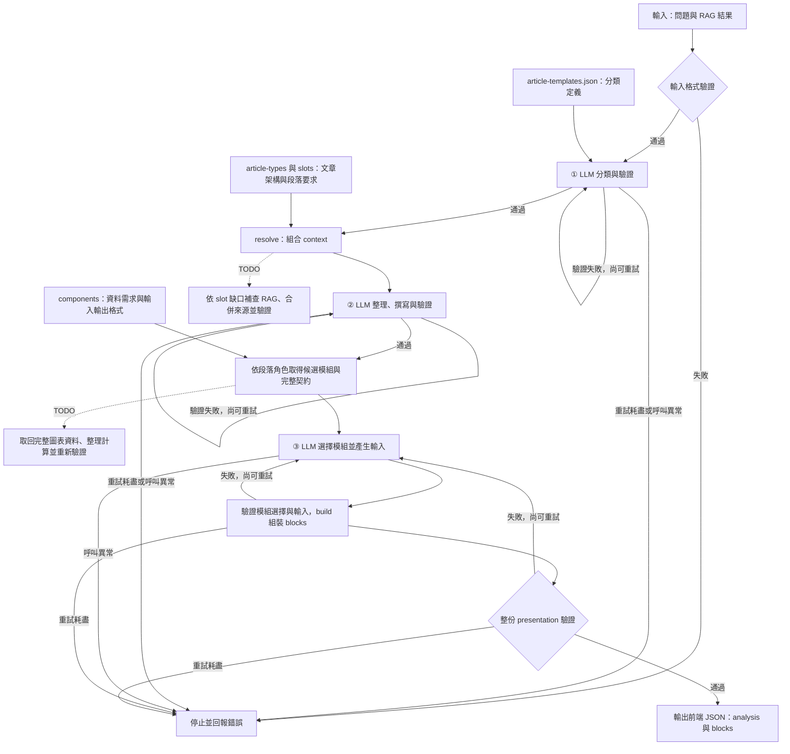

# Python workflow 流程圖

執行入口為 [pipeline.py](../scripts/pipeline.py) 的 `run_workflow()`；定義載入與前端組裝由 [workflow.py](../scripts/workflow.py) 負責。正常流程呼叫模型三次，以下虛線標出的 TODO 為預留接入點，目前尚未執行。

## 三個模型階段

| stage | 輸入 | 產出與檢查 |
| --- | --- | --- |
| classification | 原始 RAG 與分類清單 | 只回傳 status、primary、secondary；驗證分類格式與合法值 |
| analysis | 原始 RAG、分類及 resolve 組出的 context | title、summary、sections、evidence、limitations、article_structure；驗證來源、分類一致性與角色映射 |
| presentation | 已驗證的 analysis、profiles、各段落候選模組及完整元件契約 | 依各 input_schema 產生 modules；驗證候選範圍，交由 build 轉換並驗證最終 presentation |

`resolve()` 會讀取選中的文章類別、各 slot、候選元件摘要與類型呈現提示。模型收到的 `profiles[].slots[].writing_guidance` 包含 `instruction`、`required_elements`、`output_checks`。第二階段依此撰寫與自查；程式檢查格式、引用與角色映射，尚不自動判斷每個必要元素的語意完整性。

目前第二階段一次撰寫全部段落。`text` 模組的正文直接取自已驗證的 section；其他模組按契約引用證據或提供結構化資料，最後輸出 `analysis` 與 `blocks`，供前端渲染。

## 驗證、重試與模型接入

三個模型階段共用 `generate_validated()`：傳入 instruction、data、response_schema、attempt，呼叫注入的 `generate(request)`，再解析 JSON 並驗證。驗證失敗時，把錯誤與先前回覆放入 repair，只重試當前階段；預設 `max_retries=1`，即首次嘗試後最多再試一次。模型呼叫或連線異常直接停止，不使用內容修復重試。

`CommandModel` 可透過外部程式的 stdin/stdout 接入模型。特定供應商的 API adapter 仍是 TODO，亦可由呼叫端自行實作 `generate(request)`。

## 尚待實作的接入點

| TODO | 位置 | 預期工作 |
| --- | --- | --- |
| llm-api | 模型 adapter | 接入實際 LLM API，依 stage 設定模型、token 預算與 timeout |
| slot-rag | resolve 之後、analysis 之前 | 依 slot 的閱讀問題與證據需求補查 RAG，去重合併來源並驗證；限制補查次數 |
| slot-writing | analysis 階段 | 視需要逐 slot 呼叫 LLM 撰寫，再合併並驗證段落、證據 ID 與角色映射 |
| chart-rag | 載入候選模組契約之後 | 取回原始完整表格或時間序列，確認期間、單位、統計口徑及來源 |
| module-data-llm | 圖表資料補查之後 | 由 LLM 抽取與正規化資料，程式執行計算；更新 RAG、段落及證據，重新驗證並重算候選模組，再產生模組輸入 |

補查失敗或材料仍不足時，保留缺口、限制與適當角色狀態，以文字及 insufficient_data 交代，不能為填滿段落或圖表而補造內容。
